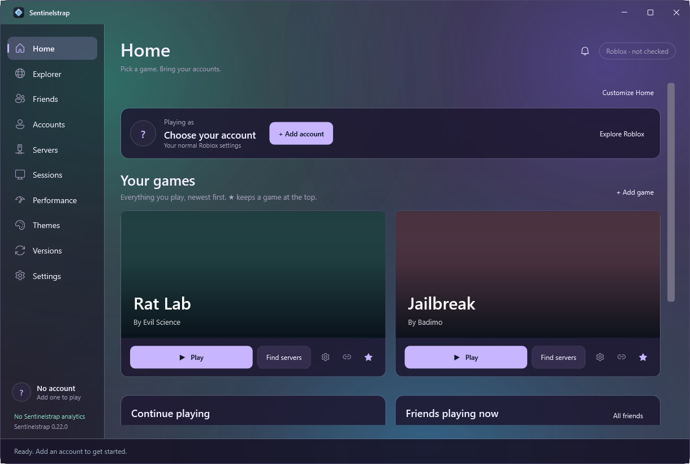
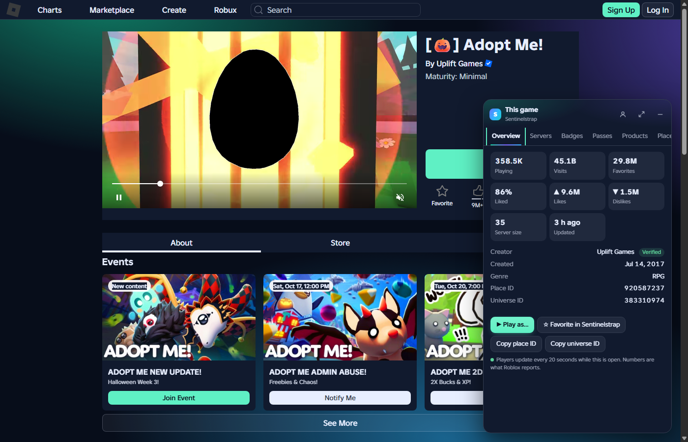
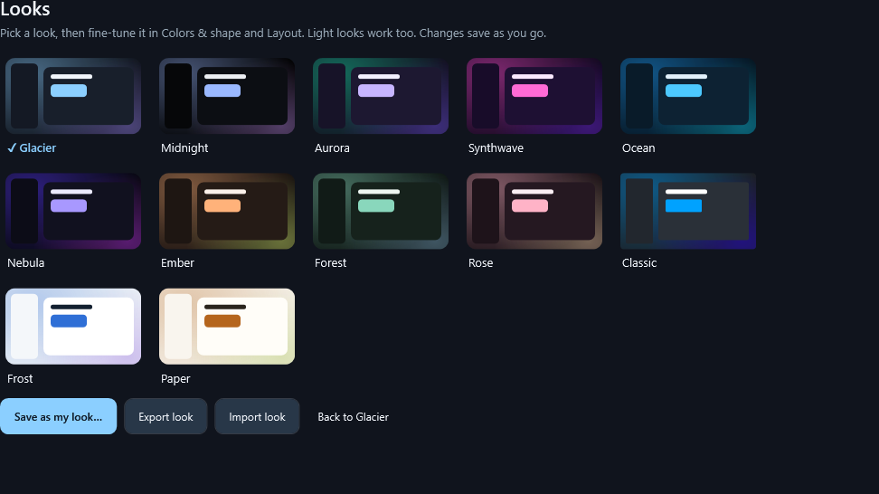

  

<h1 align="center">Sentinelstrap</h1>

  A Roblox launcher for Windows with a whole app around it, 
  and a browser extension that brings it to roblox.com.

  <a href="https://github.com/DestroyersTaken/Sentinelstrap/releases/latest"><b>Download for Windows</b></a>
  &nbsp;·&nbsp; <a href="#the-website-extension">Website extension</a>
  &nbsp;·&nbsp; <a href="#safe-by-design">Safe by design</a>
  &nbsp;·&nbsp; <a href="PRIVACY.md">Privacy</a>

## Why Sentinelstrap

**Play your way.** Website Play buttons and `roblox://` links open Sentinelstrap. It installs and updates Roblox from Roblox's own servers, applies your mods, FastFlags and launch screen, and starts the game with the account you picked.

**Every account, one click.** Add accounts through Roblox's own sign-in. Give each one its own FPS cap, graphics, volume and sensitivity. Launch a whole group into the same game and their windows go back where you left them.

**Find the right server.** Sort by players, show free slots only, join the busiest or emptiest server, or type a username and join them. Server cities through RoValra if you turn it on.

**Keep every window in reach.** Live previews of each Roblox window with CPU, memory and volume. Rejoin after a disconnect, quiet the windows you aren't using, and look back at every server you visited.

**Make it yours.** 13 looks (Halloween included) with a living background and snow, shooting stars or bats, your own colors and fonts, picture or video wallpapers, a widget Home you arrange by dragging, launch screens that show the game you're joining (or look like the classic Roblox launchers), and custom cursors and fonts inside Roblox.

**Find anything.** Ctrl+K searches commands, settings, games, accounts, friends and servers.

## The website extension

The Sentinelstrap extension for Chrome, Edge, Brave, Opera and Vivaldi adds a panel to roblox.com:

- **Games:** live player count, a server browser (smallest, largest, random, friends here, your recent servers), badges with rarity, passes, developer products and your playtime.
- **Profiles:** all their games, communities, outfits, badges, mutual friends, past names and private notes only you see.
- **You:** friends online with Join, your games with one-click Play, search, and who unfriended you.
- **Items and trades:** resale charts, optional Rolimons values and a trade panel that shows who comes out ahead.
- **Play as any saved account** from a game page, a game tile or a right-click.
- **Site themes:** live Halloween, Aurora, Synthwave and Nebula themes with bats, snow or shooting stars, eight still ones, or your own colors and picture.

Get it from the **[Chrome Web Store](https://chromewebstore.google.com/detail/sentinelstrap-for-roblox/fmmgnackbjngeppdeofephlidjhpifnc)** (works in Chrome, Edge, Brave, Opera and Vivaldi), or from Sentinelstrap: **Settings → Connections → Roblox website → Set up**. It connects to the app by itself.

## Install

1. Download **Sentinelstrap-Setup-x.y.z.exe** from [the latest release](https://github.com/DestroyersTaken/Sentinelstrap/releases/latest).
2. Run it. It installs for your Windows user only, no administrator needed. If the .NET 10 Desktop Runtime or WebView2 is missing, setup links Microsoft's official downloads.
3. Answer a few questions in guided setup. Sentinelstrap keeps itself up to date from there.

Windows SmartScreen can warn about new apps that aren't code-signed yet. Choose **More info → Run anyway** if you trust the download.

Coming from Bloxstrap, Fishstrap or Voidstrap? **Settings → Getting started → Import from Bloxstrap/Fishstrap** brings over your allowed FastFlags, mods, launch screens and companion apps.

## Safe by design

- No analytics and no tracking.
- No client patching, no injection, no anti-cheat bypass. Only FastFlags on Roblox's own allowlist.
- Accounts are added through Roblox's sign-in and kept encrypted on your PC. No passwords are saved, and sessions are only ever sent to Roblox.
- Server cities (RoValra) and item values (Rolimons) stay off until you turn them on, and never get your account.
- The extension never buys, chats, or sends or accepts trades. Decline and Cancel only happen when you click and confirm.

## Requirements

Windows 10 or 11 (64-bit), the .NET 10 Desktop Runtime and the Microsoft Edge WebView2 Runtime. Setup helps with both.

---

Sentinelstrap is not affiliated with or endorsed by Roblox Corporation.
